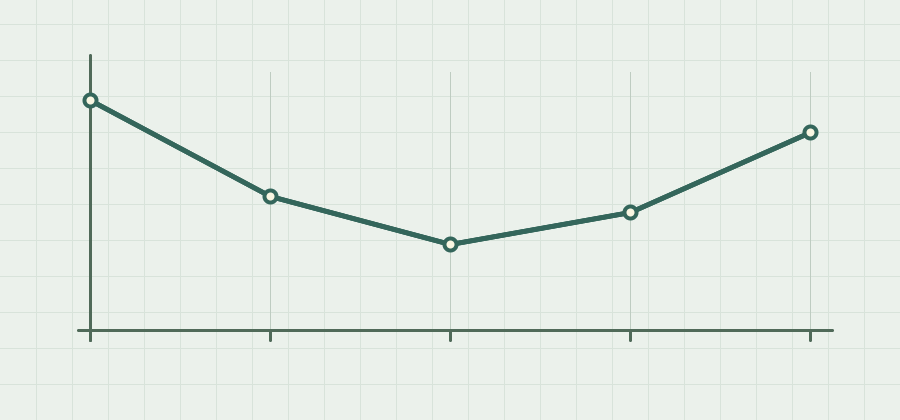

把一根短杆固定在方格纸旁，沿着同一方向标下影尖的位置。一小时后，纸上就有了一段可以回读的时间。

## 从一个原点开始

纸角对准同一块地砖，给杆脚画一个小圆点。每隔半小时做一次记号，笔尖尽量靠近影子的边缘。

### 记录表

下面是一组用来练习画图的示例数值，长度单位为厘米。

| 时间 | 10:00 | 11:00 | 12:00 | 13:00 | 14:00 |
| --- | --- | --- | --- | --- | --- |
| 长度 | 24 | 18 | 15 | 17 | 22 |

## 图上的转折点

设杆高为 $h$，影长为 $s$，太阳高度角为 $\alpha$，理想平面上有

$$
s=\frac{h}{\tan\alpha}.
$$

图中最短的影子出现在第三个采样点。为了将一天的读数浓缩成一句话，可以再试试[取中位数的方法](三次读数.md#动手算一次)。
